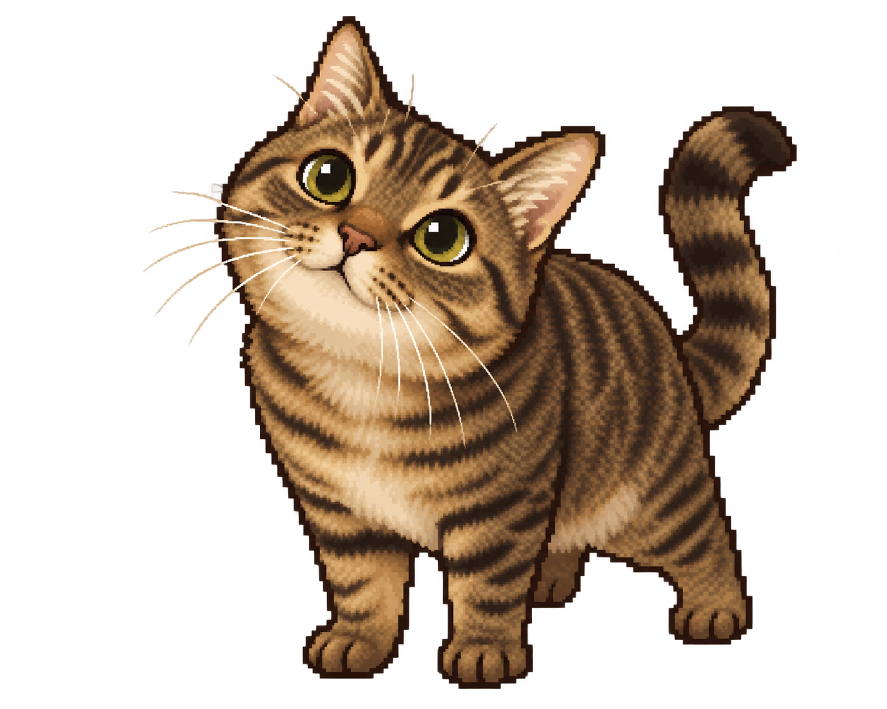

# 狸花猫桌面宠物 PRD（讨论稿）

日期：2026 年 10 月 21 日  
阶段：首版应用开发中；已接入同形象关键姿态，细化逐帧过渡待制作

## 1. 产品概述

把用户自己的狸花猫做成常驻桌面的像素宠物。猫咪平时在屏幕边缘待着；点击它，可以记录当天要做的事，查看今日待办和写一张便签。完成任务时，用户选择对应项目，猫咪把任务卡片吃掉，随后拉出一小团像素便便，作为轻松的完成反馈。

首版面向 macOS。核心体验是「看见自己的猫 → 记下今天的事 → 完成一项 → 喂给猫咪」，不依赖账号或联网。

## 2. 目标与边界

| 项目 | 首版要求 |
| --- | --- |
| 主要目标 | 让用户快速记录、查看和完成今日待办；每次完成都有猫咪动画反馈。 |
| 次要目标 | 用简短便签记录不需要勾选的内容。 |
| 使用场景 | 工作、学习或日常生活中，猫咪常驻桌面；用户随时点击查看。 |
| 暂不包含 | 云同步、团队协作、复杂提醒和周期任务、养成数值、应用商店发布。 |

## 3. 猫咪形象与像素素材

### 3.1 照片中的识别特征

根据用户提供的两张照片，角色应保留棕金色底毛、深棕近黑的狸花条纹、偏大的黄绿色眼睛、浅色下巴与嘴边、白色长胡须，以及自然的三角耳和条纹前腿。整体体态偏结实、亲近人。像素化允许适度夸张眼睛和脸颊，但不能画成橘猫，也不添加照片里没有的叶子、衣服或项圈。

采用温暖、手工感的农场游戏像素氛围，角色造型和逐帧动画均为原创，不复用现成游戏素材。人物、手和照片背景均不进入宠物素材。

用户选定的猫咪形象如下，首版应用待机时直接使用这张原图。此图为锁定的角色定稿；后续姿态只能在同一只猫的脸型、眼睛、毛色、条纹、尾巴和像素质感上延展，不得重新设计角色。当前已制作坐、趴、蹭、跳和背身等关键姿态，正式动作素材仍需继续细化逐帧过渡。

### 3.2 素材交付清单

先确定一张角色设定图：正面、左侧、右侧、背面各一张，统一毛色、纹路位置、眼睛和尾巴比例。再制作以下透明背景的逐帧像素图；每帧使用相同画布、基准线和角色中心点，避免播放时跳动。

| 动作 | 用途 | 建议帧数 |
| --- | --- | ---: |
| 站立呼吸、眨眼、坐下 | 桌面待机与低频随机动作 | 各 4–6 帧 |
| 左右行走、转身 | 拖动后的短距离移动或闲逛 | 各 6–8 帧 |
| 被点击、看向便签 | 打开面板时的回应 | 各 3–4 帧 |
| 张嘴、咀嚼、吞咽 | 吃掉选中的任务卡片 | 合计 8–12 帧 |
| 蹲下、拉便便、甩尾、得意 | 任务完成的收尾动作 | 合计 8–12 帧 |
| 像素便便、任务卡片、完成星星 | 动画道具 | 独立透明素材 |

建议先做 64 × 64 像素的角色源画布，在桌面以整数倍放大并使用最近邻缩放。正式尺寸以角色设定图的辨识度测试为准。动画素材应分层保存源文件，并导出透明 PNG 序列或图集；用户可以单独查看每个动作。

## 4. 用户流程

### 4.1 记录今天要做的事

1. 单击猫咪，弹出紧挨猫咪的「今日小纸条」。
2. 在顶部输入框输入任务，按 Enter 或点「添加」。新任务进入今日未完成列表；输入框保留焦点，方便连续添加。
3. 切换到「便签」页，可写一段当天的自由文本，停止输入后自动保存。
4. 点击面板外或按 Esc 收起面板。猫咪继续在桌面待机。

### 4.2 完成一项任务

1. 再次单击猫咪，面板显示今日未完成任务及已完成数量。
2. 点击某条任务的「喂给猫咪」按钮。该任务卡片从列表飞向猫咪嘴边。
3. 猫咪依次播放预备起跳、接住任务、咀嚼、转身、拉便便和放松动作。整段动画目标时长约 4–5 秒；像素便便短暂停留后淡出，避免桌面堆积。
4. 任务进入「今天已完成」折叠区，显示完成时间；完成数量加一。提供短时「撤销」入口，撤销后任务回到未完成列表。

动画期间同一任务不可重复触发；其他任务仍可查看，但新的喂食动作排队执行。应用退出或动画中断时，以已保存的任务状态为准，重开后不重复播放，也不丢失记录。

动作必须有预备、主动作和收势，使用缓入缓出和短暂姿态过渡；待机呼吸、蹭头与尾巴摆动不能机械地整帧硬切。角色造型始终遵循 3.1 中锁定的定稿。

## 5. 界面与交互要求

| 区域 | 交互要求 |
| --- | --- |
| 桌面猫咪 | 默认透明背景、无窗口边框；可拖动位置；单击打开或收起面板。拖动和单击有明确区分。 |
| 今日小纸条 | 默认展示任务输入框、未完成列表和完成计数；可切换便签页；不遮挡猫咪脸部。 |
| 任务行 | 显示完整任务文字和「喂给猫咪」操作；支持编辑、删除；长文字自动换行。 |
| 已完成区 | 默认折叠，保留当天完成记录和完成时间，可撤销。 |
| 系统菜单栏 | 可重新显示猫咪、暂停闲逛、开关声音、退出应用。 |

猫咪停靠屏幕边缘时，面板根据剩余空间向左或向右展开。多显示器切换后位置保持在可见区域。进入全屏应用时，首版默认不压在全屏内容之上；用户可通过菜单栏找到它。动画音效默认关闭，可在设置中开启。提供「减少动态效果」选项，开启后用简短的吃掉与完成反馈替代完整动画。

## 6. 待办与便签规则

- 「今天」按用户电脑的本地日期计算。任务包含标题、计划日期、创建时间、完成状态和完成时间；空白任务不能添加。
- 当天未完成任务按创建顺序显示。跨日仍未完成的任务在次日标注「之前未完成」，用户可以继续完成，不自动删除。
- 便签按日期保存；打开时默认看到今天的内容。历史记录可在面板中按日期查看。
- 数据保存在本机；重启应用后任务、便签、完成记录和猫咪位置仍在。首版无登录要求。
- 删除任务与完成任务是两种不同操作。完成会触发吃掉与拉便便动画；删除不会触发动画。

## 7. 首版验收标准

1. 用户能在猫咪面板中添加、编辑、删除今日任务，并能写入、修改今日便签；重启后内容不丢失。
2. 点击某条未完成任务的「喂给猫咪」后，只完成该条任务；任务卡片、吃东西和拉便便动画按顺序播放一次。
3. 动画中连续点击或应用意外退出，不会让同一任务重复完成或丢失。
4. 已完成任务能在当天列表中找到，短时可撤销；跨日未完成任务仍可处理。
5. 猫咪可拖动，面板在屏幕边缘和多显示器环境中保持可见；退出后再次打开仍记得位置。
6. 角色在待机、行走、吃任务和拉便便等状态下，保持同一只狸花猫的纹路、配色和体态。
7. 连续观察 30 秒，待机、悬停和喂食动作无明显卡顿或突然跳位；用户开启「减少动态效果」后仍能辨认完成反馈。

## 8. 待确认的产品选择

1. 猫咪的称呼或名字：用于应用名、面板标题和可能出现的提示语。
2. 动画喜好：便便保持现在的短暂停留，还是作为「今日完成成果」留在桌面，直到当天结束。
3. 是否希望猫咪自动在桌面闲逛；首版建议默认只在小范围内偶尔移动，且可随时暂停。

